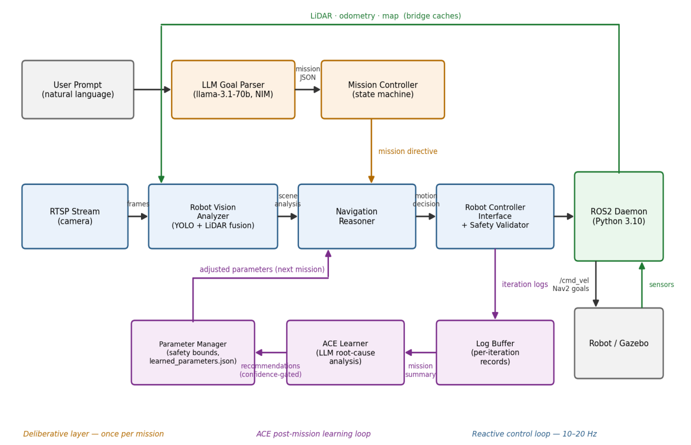
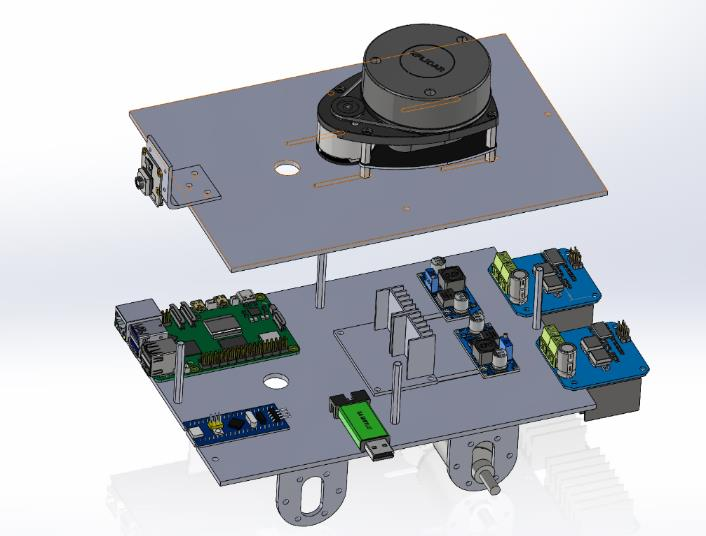
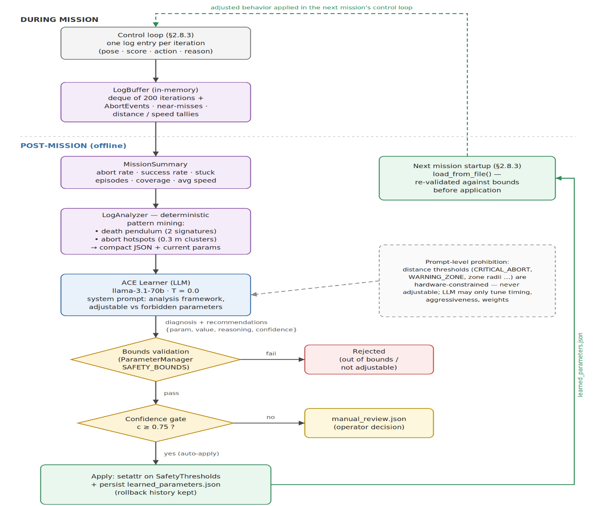
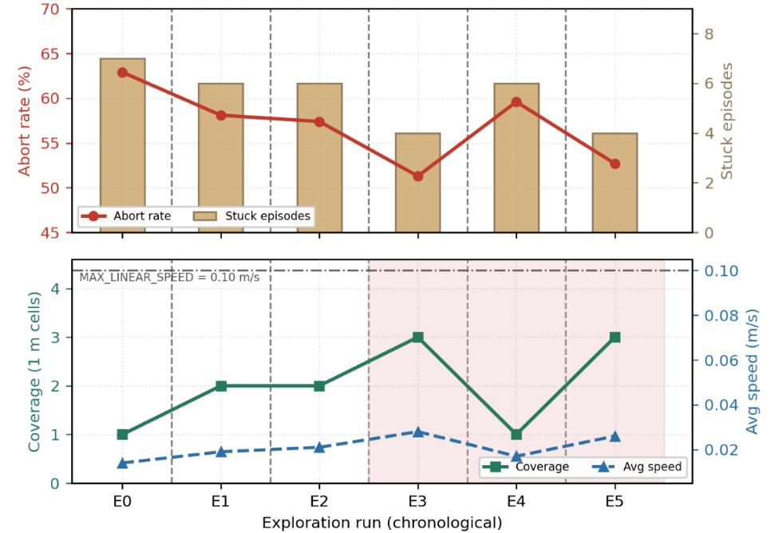
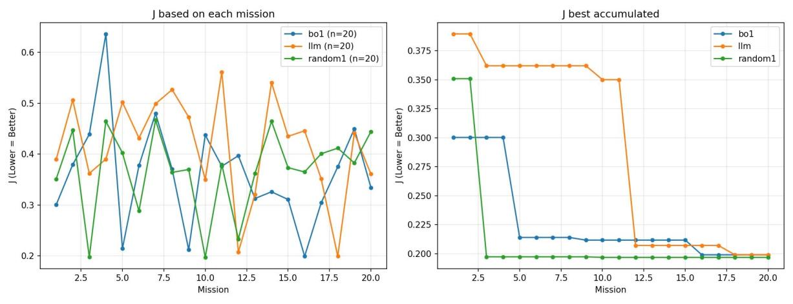
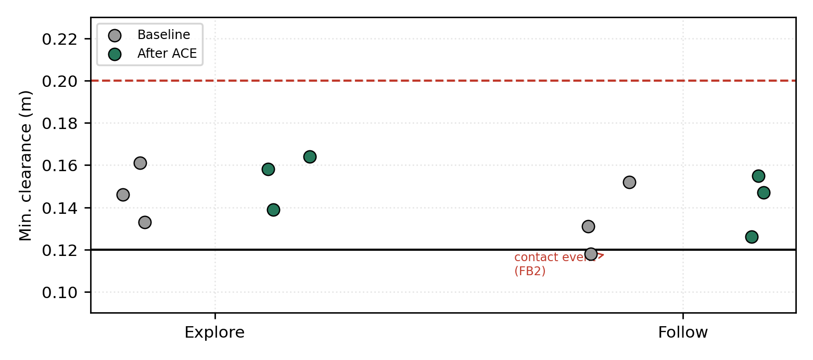

# Autonomous Robot Integrated with ACE (Agentic Context Engineering)


**Graduation project:** HCMC University of Technology and Engineering (HCMUTE), Faculty of Mechanical Engineering, Department of Mechatronics, July 2026.

| | |
|---|---|
| **Supervisor** | Cai Viet Anh Dung |
| **Students** | Nguyen Hung Dung (22134002), Tran Nhu Hoang (22134006) |

We built a two-wheel differential-drive robot (TurtleBot3 class) that takes **natural-language missions**, explores and maps with **LiDAR + SLAM**, follows people with **YOLO + LiDAR fusion**, and runs a post-mission **ACE** loop. In the ACE loop an LLM reads the robot's own mission log, diagnoses what went wrong, and proposes navigation-parameter changes. Every change must stay inside a safety envelope enforced in code and pass a confidence gate before it is applied.

> Every quantitative result in this README comes from the **physical robot**. Gazebo was used only to check the pipeline before hardware deployment.

---

## Contents

1. [Key results at a glance](#1-key-results-at-a-glance)
2. [System architecture](#2-system-architecture)
3. [Hardware](#3-hardware)
4. [Software modules](#4-software-modules)
5. [Repository structure](#5-repository-structure)
6. [Getting started](#6-getting-started)
7. [Experimental results](#7-experimental-results)
8. [Conclusion, limitations and future work](#8-conclusion-limitations-and-future-work)

---

## 1. Key results at a glance

| Objective | Status | Evidence |
|---|---|---|
| Build a two-wheel differential-drive platform | ✅ Achieved | Chassis, power, motor drive, encoders and UART telemetry ran through all 12 pilot runs |
| ROS2 + SLAM (+ Nav2) control system | ⚠️ Partially achieved | Python 3.11 ↔ 3.10 ROS2 bridge ran on every run. SLAM saved a map every run, but 4 of 6 maps were unusable because of odometry drift. Nav2 was disabled for the whole campaign |
| YOLO + LiDAR fusion for obstacle awareness | ✅ Achieved | Bearing-based fusion with tagged distance sources, 4-zone LiDAR analysis, independent safety monitor |
| LLM natural-language mission parser | ✅ Achieved | Two-tier closed-world parser, composite missions with branching, schema and whitelist checks in code |
| ACE loop, evaluated against baselines | ⚙️ Mechanism works, benefit not shown | ACE vs. random search vs. Bayesian optimisation, 20 missions each: **no significant difference**, F(2, 57) = 1.85, p = 0.167 |

**What the project shows:**

- **The full pipeline works on hardware.** A natural-language command goes through the parser, mission state machine, fused perception, reactive reasoner and the cross-interpreter ROS2 bridge, and ends as motion on the real robot.
- **ACE stays inside its limits.** It only applied changes its validators allowed. It sent uncertain suggestions to manual review and never reversed one of its own changes. It also tried to enlarge `CRITICAL_ABORT`, and the code-level safety envelope rejected it.
- **ACE gave no measurable benefit here.** The three cost terms that parameter tuning can affect (abort, stuck, failure) were already **zero in all 60 comparative missions**. About 75% of the remaining cost came from a speed ceiling set in firmware. The bugs that ACE was built to fix had already been removed by changes to the controller structure.
- **Three ways an LLM optimiser can look like it works when it does not**, which only showed up because the loop was measured against a single scalar cost: (1) copying the worked example from its prompt instead of diagnosing the run, (2) reporting the confidence the prompt asked for instead of a calibrated one, (3) reading its own parameter history the wrong way round.
- **Safety:** every approach below the 0.20 m abort radius triggered an abort, with no missed detections. There was one low-speed contact (about 0.02 m/s), caused by the LiDAR's 0.12 m blind radius, which software cannot see into.

---

## 2. System architecture



The system runs in three layers at different speeds:

| Layer | Rate | Components |
|---|---|---|
| **Deliberative** | Once per mission | LLM goal parser (`meta/llama-3.1-70b-instruct` via NVIDIA NIM, T = 0.0), mission controller |
| **Reactive control loop** | 10–20 Hz | RTSP stream → Robot Vision Analyzer (YOLO + LiDAR fusion) → Navigation Reasoner → Robot Controller Interface + Safety Validator → ROS2 daemon (`/cmd_vel`) |
| **ACE learning** | After each mission | Log buffer → Log Analyzer → ACE Learner (LLM) → Parameter Manager → `learned_parameters.json` |

The whole control stack is exposed to the NeMo Agent Toolkit as **one tool**, `robot_vision_controller`, inside a `tool_calling_agent` with `max_iterations: 1`. The LLM makes one routing decision per mission. The real-time loop runs inside the tool, so LLM latency never enters the 20 Hz obstacle-avoidance loop.

**Control loop (7 steps, 50 ms per pass):** take an atomic sensor snapshot → run YOLO+LiDAR fusion at 2 Hz (cached 0.5 s) → update the mission state machine → check completion → choose Nav2 or the reactive reasoner → run the safety validator (a rejected command becomes `safety_override` stop) → execute and append to the ACE log.

---

## 3. Hardware



| Component | Qty | Role |
|---|---|---|
| Raspberry Pi 5 (16 GB) | 1 | High-level computer: sensor bridges, camera streaming |
| STM32F103C8T6 "Blue Pill" | 1 | Real-time tier: PWM, quadrature encoders (TIM3/TIM4), failsafe stop |
| JGB37-520 12 V 333 rpm gear motor with encoder | 2 | Differential drive |
| BTS7960 H-bridge driver | 2 | Motor power stage (43 A peak) |
| RPLiDAR A1M8 (360°, 0.15–12 m) | 1 | Obstacle detection + SLAM |
| Raspberry Pi Camera Module 3 | 1 | YOLO target detection over RTSP (640×480 @ 10 FPS) |
| LiPo 3S 11.1 V 2200 mAh | 1 | Main power (~34 min usable at 80% DoD) |
| XL4016E1 8 A buck (5 V/5 A) | 1 | Raspberry Pi 5 rail |
| LM2596S 3 A buck (5 V) | 1 | STM32 + LiDAR rail |
| ST-LINK V2 | 1 | STM32 programming/debug (SWD) |

**Power budget:** about 2.5 A nominal cruising, about 3.3 A in autonomous operation, about 8 A absolute peak (motor stall). This is well within the pack's 44 A (20C) rating.

**Chassis:** double-deck layout. Camera and LiDAR are on the top deck, with the camera boresight aligned to LiDAR 0° so no extrinsic calibration is needed. Electronics and battery sit in the middle cavity. Motors, wheels and caster are on the bottom deck.

**STM32 pin map** (`STM32_Test/src/main.cpp`):

| STM32 pin | Function |
|---|---|
| PA0 / PA1, PB0 / PB1 | Motor 1: RPWM / LPWM, R_EN / L_EN |
| PA8 / PA9, PB4 / PB5 | Motor 2: RPWM / LPWM, R_EN / L_EN |
| PA6 / PA7 (TIM3) | Encoder 1 C1/C2 |
| PB6 / PB7 (TIM4) | Encoder 2 C1/C2 |
| PB10 / PB11 (USART3, 115200 baud) | UART to the Raspberry Pi via CH340K |

The firmware has a **500 ms command timeout**: if no command arrives in time, the motors stop automatically.

---

## 4. Software modules

All modules live under `src/multi_function_agent/_robot_vision_controller/`.

### 4.1 Cross-interpreter ROS2 bridge (`core/ros2_node/`)
NeMo Agent Toolkit needs **Python 3.11+**, but ROS2 Humble's `rclpy` is built for **Python 3.10**. The agent therefore runs in 3.11 and talks to a persistent 3.10 daemon (`ros2_daemon_script.py`) over three channels:

| Channel | Direction | Payload |
|---|---|---|
| stdout (JSON lines) | Daemon → agent | `/scan`, `/odom`, `/map` metadata, Nav2 state |
| stdin | Agent → daemon | `nav2_goal`, `nav2_cancel`, `slam_save_map` (exactly once, in order) |
| Shared file | Agent → daemon | `linear,angular` setpoint (latest wins), republished at 20 Hz on `/cmd_vel` |

### 4.2 Perception (`perception/`)
- **YOLO11n** (ONNX on CPU, **56.1 ms/frame** on the Pi 5). Chosen for the latency budget: it is more accurate than YOLOv8n with fewer parameters and FLOPs.
- **Camera–LiDAR fusion:** bearing θ = (u − 320)/640 × 62°, then look up the 360° scan within ±5°. If no LiDAR return is found, fall back to a monocular estimate from bounding-box height, tagged as `heuristic`.
- **Spatial detector:** four zones (FRONT / LEFT / RIGHT / BACK) and a 0–10 safety score.
- **Frontier detector:** SLAM-aware. Scores candidates by distance × proximity penalty × wall-adjacency penalty × direction bonus.
- **LiDAR monitor:** standalone range oracle that drives `CRITICAL_ABORT` and checks rear clearance.

### 4.3 Navigation reasoner (`navigation/`)
Reactive, geometry-based, easy to audit, and parameterised so ACE can tune it.

| Regime | d<sub>min</sub> | Policy |
|---|---|---|
| Safe | > 0.80 m | Frontier-guided forward motion |
| Warning | 0.50–0.80 m | Steer away from the closest zone |
| Critical | ≤ 0.50 m | Escape steps in order: forward creep → rotate toward best clearance → micro-backup → stop |

An **anti-oscillation hierarchy** (prefer moving forward, with a rule that breaks rotation loops) prevents the "death pendulum" of turning left and right between two walls. A **positional watchdog** (5 cm window, 10 checks) triggers a random-direction recovery rotation. The execution layer checks safety on **every 50 ms pulse**. Any obstacle inside 0.20 m in the ±60° front arc causes an abort, sent as five back-to-back stop commands.

### 4.4 Mission system (`core/mission_controller/`)
Strategy pattern over `BaseMission`: `follow_target`, `explore_area`, `patrol_laps`, `path_following`, `composite_mission`. Composite missions are a validated state machine (`INIT → EXECUTING → TRANSITIONING → COMPLETE/ERROR`). Steps are checked before the mission starts, at runtime and after each step, and support `condition_check` branches and `directional_command` steps.

### 4.5 Natural-language parsing (`core/parser/`, `core/text/`)
- **Two-tier routing:** a cheap keyword rule sends a command either to the composite planner or to the simple classifier. If the composite parser fails, the command falls back to the simple tier.
- **Closed world:** the model must answer `"unsupported"` for anything outside the known mission types, and the code checks the mission type against a whitelist.
- Settings that a regular expression can extract (stream URL, safety level) are extracted by `QueryExtractor`, not by the LLM.

Example commands:
```text
Control robot using rtsp://172.17.0.1:8554/robotcam and explore for 60 seconds
Control robot using rtsp://172.17.0.1:8554/robotcam and explore 120 seconds, if you see a person follow them, otherwise stop
Control robot using rtsp://172.17.0.1:8554/robotcam and go around 20 times for 60 seconds
```

### 4.6 ACE: Agentic Context Engineering (`core/ace/`)



ACE follows three design rules:
1. **Learning happens only after the mission.** The LLM never runs inside the real-time loop.
2. **Code detects patterns; the LLM only interprets them.** The death-pendulum and abort-hotspot detectors run in code (`log_analyzer.py`), so the same log always produces the same evidence.
3. **The LLM proposes; code decides.** Every recommendation has to pass the immutable `SAFETY_BOUNDS` and a confidence gate (`parameter_manager.py`).

**Adjustable parameters and their safe ranges.** This table is a class constant, not configuration. All distance thresholds are permanently excluded from tuning.

| Group | Parameter | Safe interval |
|---|---|---|
| Recovery timing | `ESCAPE_DURATION` | [1.5, 3.0] s |
| | `ROTATION_DURATION` | [0.8, 2.0] s |
| | `BACKUP_DURATION` | [1.5, 3.0] s |
| Aggressiveness | `CREEP_SPEED_MULTIPLIER` | [0.3, 0.7] |
| | `TURN_AGGRESSIVENESS` | [0.4, 0.8] rad/s |
| Decision weights | `FRONTIER_PREFERENCE_WEIGHT` | [0.5, 1.0] |
| | `STUCK_PENALTY_MULTIPLIER` | [1.0, 2.0] |
| Stuck detection | `STUCK_THRESHOLD` | [3, 10] iterations |
| | `STUCK_POSITION_TOLERANCE` | [0.03, 0.10] m |
| | `ABORT_SPAM_THRESHOLD` | [5, 15] |

Accepted changes are saved to `configs/learned_parameters.json`, with history and rollback via `rollback_last()` and `rollback_all()`. They are checked against the bounds again when the next mission starts. Suggestions below the confidence gate go to `manual_review.json` for a human to decide.

### 4.7 Containerisation (`docker/`)
The image contains both Python environments side by side: a 3.11 venv with NAT, ultralytics, PyTorch and OpenCV, and system Python 3.10 with ROS2 Humble and CycloneDDS. Storage works like this:

- Code is bind-mounted from the host, so edits apply without rebuilding the image.
- YOLO weights and ROS2 message packages live in named volumes (`nat_models`, `nat_ros2`).
- The container runs with `--network=host` so DDS multicast discovery works.

### 4.8 Web GUI (`gui_controller/`)
FastAPI backend (REST + WebSocket telemetry through `ros2_bridge.py`) and a React + Vite + Tailwind frontend. The frontend has mission launch, an RTSP stream selector, a free-text prompt box and a live trajectory viewer.

---

## 5. Repository structure

```text
final-project/
├── src/multi_function_agent/
│   ├── register.py                          # NAT function registration (robot_vision_controller)
│   ├── configs/
│   │   ├── config.yml                       # Agent, LLM, safety, SLAM, Nav2 configuration
│   │   └── learned_parameters.json          # ACE output, loaded at next mission start
│   └── _robot_vision_controller/
│       ├── main.py                          # Entry point: startup + perception–decision–action loop
│       ├── test_integration.py              # Layered integration tests (bridge → vision → nav → mission)
│       ├── core/
│       │   ├── ace/                         # log_analyzer.py, ace_learner.py, parameter_manager.py
│       │   ├── parser/                      # goal_parser.py (simple), composite_mission_parser.py
│       │   ├── text/                        # System prompts (mission parser, composite DSL, ACE analysis)
│       │   ├── mission_controller/          # Orchestrator, validator, missions/ (follow, explore, patrol,
│       │   │                                #   path_following, composite, condition_check, directional)
│       │   ├── ros2_node/                   # ros2_node.py (3.11 side), ros2_daemon_script.py (3.10 side)
│       │   ├── models.py                    # Singleton YOLO model manager
│       │   └── query_extractor.py           # Regex-based parameter extraction
│       ├── perception/                      # robot_vision_analyzer, rtsp_stream_handler, lidar_monitor,
│       │                                    #   slam_controller, detector/{spatial,frontier}_detector
│       ├── navigation/                      # navigation_reasoner, robot_controller_interface, nav2_interface
│       └── utils/                           # safety_checks, movement_commands, geometry, ROS stubs, logging
├── robot_ws/                                # Real-robot bring-up (Pi bridges + laptop ROS2 nodes)
│   ├── lidar_bridge.py, robot_bridge.py     # [Pi] RPLiDAR → TCP 9001; STM32 ↔ TCP 9002/9003
│   ├── pi_camera_stream.sh                  # [Pi] CSI camera → H.264 → RTSP push
│   ├── pi_robot_node.py                     # [Laptop] encoders → /odom + TF; /cmd_vel → motor PWM
│   ├── lidar_ros2_node.py                   # [Laptop] TCP → /scan (LaserScan)
│   ├── slam_launch.py                       # static TF base_link→laser + slam_toolbox (async)
│   ├── start_robot.sh / start_robot_ai.sh   # One-shot launchers (teleop / AI agent)
│   └── ROBOT_AI_GUIDE.md                    # Detailed operating guide (Vietnamese)
├── STM32_Test/                              # PlatformIO firmware (Blue Pill, Arduino framework)
├── docker/                                  # Dockerfile, build/run scripts, Gazebo launchers
├── gui_controller/                          # backend/ (FastAPI) + frontend/ (React + Vite)
├── maps/                                    # Saved SLAM map (my_map.pgm / .yaml, 0.05 m/px)
├── docs/images/                             # Figures used in this README
├── yolo11n.pt                               # YOLO weights (Git LFS)
└── pyproject.toml                           # Python package `multi_function_agent` (NAT plugin)
```

---

## 6. Getting started

### 6.1 Prerequisites
- Ubuntu 22.04 with **ROS2 Humble**, `slam_toolbox`, `rviz2` (and `turtlebot3_gazebo` for simulation)
- **Docker** (the agent runs in a container)
- [MediaMTX](https://github.com/bluenviron/mediamtx) binary at `~/mediamtx` (RTSP server)
- An **NVIDIA API key** for NIM (`meta/llama-3.1-70b-instruct`)
- Node.js + npm (for the GUI), PlatformIO (for the firmware)
- Git LFS (`git lfs pull` fetches `yolo11n.pt`)

### 6.2 Build the container
The scripts expect this repo to sit inside an NVIDIA NeMo Agent Toolkit checkout at `~/nemo-agent-toolkit/examples/multi_function_agent`:

```bash
git clone https://github.com/NVIDIA/NeMo-Agent-Toolkit.git ~/nemo-agent-toolkit
```

```bash
git clone https://github.com/jerrynguy/final-project.git ~/nemo-agent-toolkit/examples/multi_function_agent
```

```bash
cd ~/nemo-agent-toolkit/examples/multi_function_agent/docker && REPO_ROOT=~/nemo-agent-toolkit NAT_VERSION=1.2.1 ./build_container.sh
```

```bash
./init_volumes.sh
```

### 6.3 Bring up the robot stack

**Option A: Gazebo simulation** (TurtleBot3 world + SLAM + RViz + RTSP). This needs a separate `rtsp_publisher.py` that is not in this repo:
```bash
./docker/start_robot_stack_explore.sh
```

**Option B: physical robot.** Copy `lidar_bridge.py`, `robot_bridge.py` and `pi_camera_stream.sh` to `~/robot_bridge/` on the Pi, and copy `robot_ws/` to `~/robot_ws/` on the laptop. Set `PI_IP` in the scripts, then run:
```bash
~/robot_ws/start_robot_ai.sh
```
Check that `ros2 topic list | grep -E 'scan|odom|map'` shows all three topics and that the ffplay window shows video. In this setup the Pi only runs light serial-to-TCP bridges and the camera stream. ROS2, SLAM and the agent run on the laptop over Wi-Fi:

```text
Pi camera ──RTSP──▶ MediaMTX (laptop:8554) ──▶ NAT agent (Docker)
LiDAR ──TCP 9001──▶ lidar_ros2_node ──▶ /scan ──▶ ROS2 daemon ──/cmd_vel 20 Hz──▶ pi_robot_node
Encoders ◀─TCP 9003── Pi ◀─serial─ STM32 ◀─serial─ Pi ◀─TCP 9002── pi_robot_node ──▶ /odom
```

### 6.4 Run a mission
```bash
export NVIDIA_API_KEY=<your-nvapi-key>
```

```bash
cd ~/nemo-agent-toolkit/examples/multi_function_agent/docker && ./run_hybrid_container.sh
```

Inside the container:
```bash
nat run --config_file /workspace/mounted_code/src/multi_function_agent/configs/config.yml --input 'Control robot using rtsp://172.17.0.1:8554/robotcam and explore for 60 seconds'
```

After editing code on the host, run `uv pip install -e .` inside the container and run the mission again. You do not need to rebuild the image.

### 6.5 Web GUI (optional)
```bash
cd gui_controller/backend && python3 main.py
```

```bash
cd gui_controller/frontend && npm install && npm run dev
```
Then open http://localhost:5173. `docker/start_robot_system.sh` starts the container, backend and frontend together.

### 6.6 Flash the STM32 firmware
```bash
cd STM32_Test && pio run -t upload
```
This uses the `bluepill_f103c8` environment and uploads over ST-LINK. Serial protocol on USART3 at 115200 baud: `M <pwm1> <pwm2>` sets the motors, and the board reports `ENC1: <n>  ENC2: <n>`.

### 6.7 Main configuration (`src/multi_function_agent/configs/config.yml`)

| Key | Value | Meaning |
|---|---|---|
| `critical_distance` / `warning_distance` / `safe_distance` | 0.20 / 0.40 / 1.00 m | Abort / caution / free-motion radii |
| `min_valid_range` / `max_lidar_range` | 0.12 / 3.5 m | LiDAR validity window |
| `max_linear_velocity` / `max_angular_velocity` | 0.1 m/s / 0.5 rad/s | Command bounds used on the real robot |
| `min_command_interval` | 0.05 s | 20 Hz command ceiling |
| `use_slam`, `slam_auto_save_interval`, `slam_min_mapping_duration` | true, 5 s, 30 s | SLAM policy |
| `use_nav2` | false | Nav2 was off during the evaluation (reactive controller only) |
| `stream_url` | `${RTSP_URL:-rtsp://172.17.0.1:8554/robotcam}` | Same config works for Gazebo and hardware |

---

## 7. Experimental results

The evaluation had **two campaigns**, run at different times with different controller versions:

| | Pilot campaign | Comparative campaign |
|---|---|---|
| Purpose | Check the scenarios, follow the ACE learning trajectory | Rank 3 optimisers on one scalar cost |
| Runs | 6 follow + 6 explore | 20 missions × 3 optimisers = 60 |
| Controller | **Before** the anti-oscillation and stuck-recovery fixes | **After** both fixes |
| Aborts / stuck | 51–65% abort rate, 4–8 stuck episodes per run | **0 aborts, 0 stuck, 0 failures** |
| Statistics | None (n = 3 per condition) | One-way ANOVA + effect sizes |

Absolute performance was low, and is reported as measured: the robot averaged 16–24% of its 0.10 m/s firmware speed ceiling and covered about 1 m of ground per minute.

### 7.1 Scenario 1: Follow target (pilot)
A person walked a slow loop (~0.4 m/s) with two reversals and one occlusion.

| | Target-loss events | Mean re-acquisition | Near-misses | Abandoned runs |
|---|---|---|---|---|
| Baseline (n = 3) | 19.3 | 11.8 s | 12.0 | 2 of 3 |
| After ACE (n = 3) | 17.0 | 10.5 s | 10.3 | 1 of 3 |

**The scenario did not work well.** The camera sits **0.14 m** above the floor, so it sees the person only from the knees down. YOLO confidence dropped to 0.29–0.53, and most target losses happened with the person in plain view. No continuous pursuit segment lasted longer than about 25 s.

### 7.2 Scenario 2: Exploration with SLAM (pilot)

| Metric | Baseline (n = 3) | After ACE (n = 3) | Δ | Run-to-run sd (E3–E5) |
|---|---|---|---|---|
| Abort rate | 61.4% | 54.5% | −6.9 pp | 4.4 pp |
| Stuck episodes / run | 6.7 | 4.7 | −2.0 | 1.2 |
| Coverage (1 m cells) | 1.3 | 2.3 | +1.0 | 1.2 |
| Average speed | 0.016 m/s | 0.024 m/s | +0.007 | 0.006 |

Every metric moved in the right direction, but **on 3 of 4 metrics the change is about the same size as the run-to-run noise**. Three of six runs ended early because the robot got stuck in a corner. SLAM saved a map on every run, but 4 of the 6 maps were unusable because odometry drift made the walls appear twice.

### 7.3 ACE learning trajectory (pilot, runs E0–E5)



| Session | Action |
|---|---|
| S1 (after E0) | `ROTATION_DURATION` 1.2 → 1.8 s (conf 0.88, applied). A request to raise `CRITICAL_ABORT` 0.20 → 0.30 m was **rejected by the safety envelope** |
| S2 (after E1) | `STUCK_THRESHOLD` 10 → 6 (conf 0.90, applied). `CREEP_SPEED_MULTIPLIER` (conf 0.71) sent to manual review |
| S3 (after E2) | `FRONTIER_PREFERENCE_WEIGHT` 1.00 → 0.62 (conf 0.82, applied). Followed by the largest single improvement, −6.1 pp |
| S4, S5 | All suggestions below the gate → manual review. **Nothing applied** |

Because S4 and S5 applied nothing, runs E3, E4 and E5 all used the same parameters, which accidentally made them a **control group**. Their abort rates (51.3%, 59.6%, 52.7%) spread about as widely as the whole baseline-to-learned improvement. The pilot shows that **ACE stays within its limits; it does not show that ACE helps.**

### 7.4 Comparative evaluation: ACE vs. random search vs. Bayesian optimisation

Each mission was scored with one cost (lower is better):

```text
J = 1.0·abort_rate + 0.5·min(stuck/min ÷ 2, 1) + 0.3·min(near_miss/min ÷ 20, 1)
  + 0.8·max(0, 1 − (m/min) ÷ 6) + 2.0·failure
```

Each optimiser got 20 explore missions of 120 s each. Missions from the three optimisers were interleaved so that drift in battery, furniture and foot traffic affected all three equally.



| Optimiser | n | Mean J | sd | Min | Max |
|---|---|---|---|---|---|
| Bayesian optimisation | 20 | **0.3615** | 0.1016 | 0.1990 | 0.6364 |
| Random search | 20 | 0.3681 | 0.0822 | 0.1968 | 0.4667 |
| ACE (LLM) | 20 | 0.4146 | 0.1006 | 0.1990 | 0.5615 |

- **One-way ANOVA: F(2, 57) = 1.85, p = 0.167**, so there is no significant difference.
- ACE vs. BO: d = 0.53, p = 0.105. ACE vs. random: d = 0.51, p = 0.118. ACE was slightly worse, but the test only had 0.37 power to detect a difference of that size.
- All three reached the same best cost (0.197–0.199).
- An earlier 8-mission series in which ACE's parameters were effectively frozen scored about the same as the active loop (p = 0.55).

**Why nothing improved:**

| Optimiser | abort_rate | stuck | failure | inefficiency | near_miss |
|---|---|---|---|---|---|
| Bayesian optimisation | 0.000 | 0.000 | 0.000 | 0.285 | 0.077 |
| ACE (LLM) | 0.000 | 0.000 | 0.000 | 0.307 | 0.107 |
| Random search | 0.000 | 0.000 | 0.000 | 0.289 | 0.079 |

The cost terms that parameter tuning can change were **zero in all 60 missions**. Most of what remained (74–79%) was the inefficiency term, which is capped by firmware speed. The tunable parameters had nothing left to improve.

**LLM failure modes found during this campaign:**
1. **Copying the prompt example.** One recommendation was a word-for-word copy of the worked example in the system prompt, including a 0.35 m clearance that does not appear anywhere in that run's log.
2. **Uncalibrated confidence.** Told to suggest changes only above 70% confidence, the model reported 0.78–0.88 every time, so the 0.75 gate let everything through. After a calibration scale was added to the prompt, it reported 0.55–0.60, and the gate let nothing through.
3. **Misreading its own history.** It claimed a change had lowered J when the recorded history showed the opposite.

### 7.5 Safety validation (12 pilot runs)



| Mechanism | Times exercised | Status |
|---|---|---|
| Per-tick `CRITICAL_ABORT` check (0.20 m) | ≥ 1 in every run, no missed detections | ✅ Validated |
| Five-fold stop publication | Every abort; 4 cases of 0.05–0.15 m extra travel | ✅ Validated, with caveat |
| Rear-clearance gate (blind reverse) | 6 | ✅ Validated |
| Startup safety manoeuvre | 2 | ✅ Validated |
| ACE safety envelope (`validate_adjustment`) | 1 (S1 rejection) | ✅ Validated |
| Nav2 supervisory abort | 0 (Nav2 disabled) | ❌ Not validated on hardware |
| LiDAR blind radius (0.12 m) | 1 contact (run FB2, ~0.02 m/s) | ⚠️ Known hardware limitation |

Minimum clearance was **0.140 ± 0.016 m before** learning and **0.148 ± 0.014 m after**. ACE neither improved nor reduced the physical safety margin.

---

## 8. Conclusion, limitations and future work

**Main conclusion:** an LLM can be given a limited, envelope-constrained role over a real robot, and it stays inside that role. On this platform and within these bounds, however, that role produced no measurable improvement, because the available improvements had already been made through changes to the controller structure.

**Limitations**
- Small samples (n = 3 per condition in the pilot). The comparative campaign could only detect effects of about 0.087 in J or larger.
- Single room and single layout, so the results may not hold in other environments.
- Hardware limits: camera mounted at 0.14 m, 0.10 m/s firmware speed ceiling, 0.12 m LiDAR blind radius, encoder scale not independently calibrated.
- The map check only verifies file size, not map content. Nav2 was not evaluated.
- Software gaps: the composite deserialiser whitelist omits `path_following`, and the `area_covered` condition is only a stub.
- The cloud LLM adds 10–60 s per session plus a dependency on network availability.

**Future work**
- Raise the camera to chest height, add PWM ramping, and calibrate encoder odometry.
- Repeat the comparison in several room layouts (about 50 missions per condition), and run ACE **during** controller development, while the controller still has faults to fix.
- Keep separate learned-parameter sets per environment (keyed by a SLAM-map fingerprint), and add one-click apply/rollback for manual-review suggestions.
- Calibrate the confidence gate against the measured change in J (reliability diagram).
- Move the learner to a smaller on-device model, and give it more parameters to tune (vision cadence, frontier weights).
- Try ByteTrack-style low-confidence association for the follow mission.

---

## Acknowledgements

We thank the professors of the Faculty of Mechanical Engineering, HCMUTE, and especially our supervisor **Cai Viet Anh Dung** for their guidance throughout this project.

## License

[Apache License 2.0](LICENSE). The project is built on [NVIDIA NeMo Agent Toolkit](https://github.com/NVIDIA/NeMo-Agent-Toolkit).
