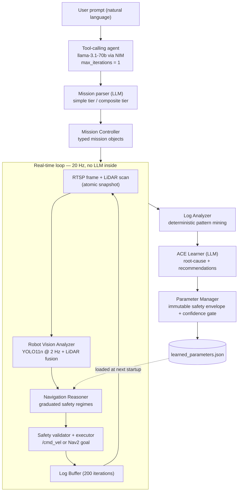
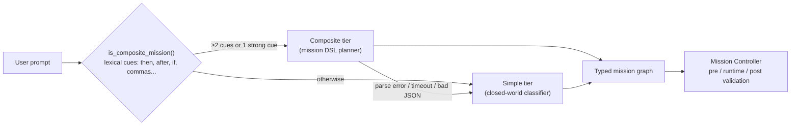
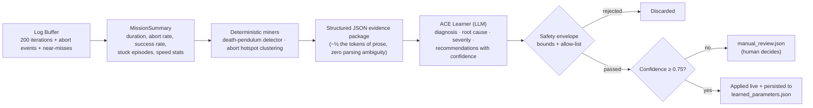

# Autonomous Robot Integrated with ACE (Agentic Context Engineering)

An autonomous mobile robot whose **AI stack** turns a free-form sentence
("*explore for 30 seconds, and if you see a person, follow them*") into a validated
mission plan, drives it with a YOLO + LiDAR perception loop, and then — after the
mission ends — asks an LLM to read its own flight log and re-tune its navigation
parameters for the next run.

> This README documents **only the AI parts** of the project: the agent layer, the
> natural-language mission compiler, the perception pipeline, the parameterised
> reasoner, and the ACE learning loop. Hardware (STM32 firmware, power design,
> chassis) and the ROS2 plumbing are covered in the thesis, not here.

Graduation project — HCMC University of Technology and Engineering, Faculty of
Mechanical Engineering, Department of Mechatronics.
All results reported below were measured **on the physical robot**, not in simulation.

---

## Table of Contents

- [1. The AI stack in one picture](#1-the-ai-stack-in-one-picture)
- [2. Where the AI lives in this repo](#2-where-the-ai-lives-in-this-repo)
- [3. Layer 1 — The tool-calling agent (NeMo Agent Toolkit)](#3-layer-1--the-tool-calling-agent-nemo-agent-toolkit)
- [4. Layer 2 — Natural-language mission parsing](#4-layer-2--natural-language-mission-parsing)
- [5. Layer 3 — Perception: YOLO11n + LiDAR fusion](#5-layer-3--perception-yolo11n--lidar-fusion)
- [6. Layer 4 — The navigation reasoner (the thing ACE tunes)](#6-layer-4--the-navigation-reasoner-the-thing-ace-tunes)
- [7. Layer 5 — ACE: post-mission learning](#7-layer-5--ace-post-mission-learning)
- [8. Running the AI stack](#8-running-the-ai-stack)
- [9. Experimental results (including the null result)](#9-experimental-results-including-the-null-result)
- [10. Limitations and future work](#10-limitations-and-future-work)

---

## 1. The AI stack in one picture

Two very different time scales share one robot. The reactive control loop runs at
**20 Hz** and cannot wait for a network round trip; the LLM layers run **once per
mission** — before it starts (parsing) and after it ends (learning).



**Three deliberately unusual design choices:**

1. **Inverted agent.** The whole robot controller is exposed to the LLM as a *single*
   tool (`robot_vision_controller`) and the agent is capped at `max_iterations = 1`.
   The agent makes exactly one routing decision; the long-horizon control loop runs
   *inside* the tool. A multi-second LLM latency is fine once per mission and
   catastrophic inside a 20 Hz obstacle-avoidance loop.
2. **The LLM interprets, it never detects.** Every behavioural pattern (death
   pendulum, abort hotspots, stuck episodes) is mined **in code** before the model is
   consulted, so identical logs always produce identical evidence.
3. **The LLM proposes, it never disposes.** Every parameter recommendation must clear
   a code-enforced, immutable safety envelope *and* a confidence gate before it is
   allowed to touch a runtime value.

---

## 2. Where the AI lives in this repo

```
src/multi_function_agent/
├── register.py                          # NAT registration (@register_function) + Pydantic config
├── configs/config.yml                   # Models, tools, workflow type, safety parameters
└── _robot_vision_controller/
    ├── main.py                          # ⭐ Entry point: the perception–decision–action loop
    │
    ├── core/
    │   ├── parser/
    │   │   ├── goal_parser.py           # Simple tier — closed-world mission classifier
    │   │   └── composite_mission_parser.py  # Composite tier — prompt-as-DSL planner
    │   ├── query_extractor.py           # Deterministic regex params (never sent to the LLM)
    │   ├── models.py                    # Singleton YOLO model manager
    │   ├── text/
    │   │   ├── mission_parser_prompt.txt          # Simple-tier system prompt
    │   │   ├── composite_mission_parser_prompt.txt# Mission-DSL specification
    │   │   └── ace_analysis_prompt.txt            # ACE failure-analyst system prompt
    │   ├── ace/                         # 🧠 The ACE loop
    │   │   ├── log_analyzer.py          # LogBuffer + deterministic pattern miners
    │   │   ├── ace_learner.py           # LLM root-cause analysis + confidence gating
    │   │   └── parameter_manager.py     # Immutable safety bounds, persistence, rollback
    │   └── mission_controller/          # Strategy-pattern mission layer + composite FSM
    │
    ├── perception/
    │   ├── robot_vision_analyzer.py     # 👁️ YOLO ↔ LiDAR fusion, monocular fallback
    │   ├── detector/spatial_detector.py # 360° angular map, 4-zone summary, safety score
    │   ├── detector/frontier_detector.py# SLAM-aware frontier scoring
    │   └── lidar_monitor.py             # Lightweight range oracle (no decisions)
    │
    └── navigation/
        └── navigation_reasoner.py       # 🧭 The reactive policy — ACE's tuning surface
```

---

## 3. Layer 1 — The tool-calling agent (NeMo Agent Toolkit)

The stack is built on **NVIDIA NeMo Agent Toolkit (NAT)**: models, tools and the
workflow type are declared in `config.yml`, and the controller is published through a
`@register_function`-decorated coroutine with a Pydantic schema (`register.py`).

NAT itself performs no inference. It resolves the declarative config, injects the tool
description into the prompt, calls a model endpoint, and dispatches the returned tool
call. That endpoint is **NVIDIA Inference Microservices (NIM)** — the weights never
live on the robot (a 70B model needs ~140 GB in FP16 against the Raspberry Pi 5's 16 GB).

```yaml
llms:
  nim_llm:
    _type: nim
    model_name: meta/llama-3.1-70b-instruct
    temperature: 0.0          # determinism, not creativity

workflow:
  _type: tool_calling_agent
  tool_names: [robot_vision_controller]
  llm_name: nim_llm
  max_iterations: 1           # one routing decision, then the tool owns the mission
```

### Why a 70B model

Both LLM consumers — the mission parser and the ACE learner — need **structural
conformance**, not creative generation: schema-valid JSON, exact parameter
identifiers, and an honest `"unsupported"` sentinel instead of an invented capability.
Because latency is paid once per mission, the larger instruction-tuned model is the
cheaper bet.

| Option | Hosting | Latency / call | Structured-output reliability |
|---|---|---|---|
| **meta/llama-3.1-70b-instruct via NIM (selected)** | Remote | 10–60 s per ACE session | High |
| llama-3.1-8b class | Remote or GPU host | Lower | Lower; more schema violations expected |
| 7B class on the Pi 5 | On-robot | Impractical on CPU-only | Not evaluated |
| 70B class on the Pi 5 | Not feasible | — | ~140 GB FP16 vs 16 GB available |

This was **not ablated** against a smaller model, and §9 gives reason to doubt model
scale was the operative variable: the three observed failure modes are failures of
*reasoning over data already in the prompt*, not of linguistic capability.

---

## 4. Layer 2 — Natural-language mission parsing

The LLM here is treated as a **semantic compiler**, not a conversational partner: its
latitude is fixed by a system prompt that acts as the formal specification of a small
mission language, temperature is pinned to 0.0, and output is accepted only if it
survives strict JSON deserialisation *and* schema validation.



### 4.1 Two-tier routing

Routing uses a **cheap lexical rule**, not an LLM call. `is_composite_mission()` looks
for sequencing and branching vocabulary ("then", "after", "if", commas, directional
verbs). The bias is deliberately toward the composite planner, because the error costs
are asymmetric: a simple command sent to the composite planner yields a valid one-step
plan, while a composite command sent to the simple planner silently loses steps.
The reverse defence is a **fallback**: any composite parser failure (timeout, malformed
JSON, transport error) is retried on the simple tier.

### 4.2 The simple tier — a closed-world classifier

`goal_parser.py` emits exactly one of three mission types under a rigid four-field
contract `{type, target_class, parameters, description}`, anchored with few-shot examples.

Its most important property is that it is **closed-world**: the prompt instructs the
model to emit the sentinel `"unsupported"` for anything outside the three known types,
*and* the parser re-enforces the same whitelist programmatically after deserialisation.
This double gate — prompt-level refusal plus code-level validation — is the defence
against the characteristic LLM-interface failure, **hallucinated capability**. The model
is never trusted to know what the robot can do; the code decides.

Three supporting details: a regex strips the operationally meaningful but semantically
noisy RTSP setup phrase before parsing; an adaptive token budget grants 500 output
tokens to composite-flavoured prompts and 100 to plain ones; and Markdown code fences
are stripped, with every failure mapped onto `MissionParsingError` /
`UnsupportedMissionError` so users get actionable messages instead of stack traces.

### 4.3 The composite tier — the prompt *is* the language definition

`composite_mission_parser_prompt.txt` specifies six step types, each step's parameter
schema, the conditional construct, the linkage convention
(`next_step_if_success`, terminating in `"mission_complete"`), and two fully worked
input→output examples. It also encodes operational lessons as parsing rules — each one
corresponding to a concrete misparse observed during development.

| Step type | Role | Key parameters |
|---|---|---|
| `explore_area` | SLAM exploration segment | `duration`, `coverage` |
| `path_following` | Parametric geometric path | `path_type` (ellipse / spiral / figure8 / circle), radii |
| `follow_target` | Object pursuit segment | `target_class`, `min/max_distance` |
| `patrol_laps` | N laps in a pattern | `count`, `shape` |
| `condition_check` | Branch point | `condition {type, target_class, timeout}`, `branch_true`, `branch_false` |
| `directional_command` | Imperative primitive | `direction`, `distance` (m) or `duration` (s) |

Deserialisation is **permissive toward step kinds, strict toward the plan**: unknown
step types are skipped with an info message, but the resulting plan must pass validation
(at least one surviving step, globally unique IDs, allowed types) before it becomes a
mission object. The LLM never executes its own graph — it is handed to the composite
state machine, which re-checks real-world preconditions per step. Stochastic language
understanding is thereby confined to *planning*; execution stays deterministic.

Finally, a deterministic `QueryExtractor` pulls out everything a regex can decide
(stream URL, caution/assertiveness vocabulary). **Anything extractable by a regular
expression should not be routed through a stochastic model.**

### 4.4 Mission validation (three phases)

| Phase | When | Checks |
|---|---|---|
| Pre-validation | At construction, before any wheel turns | SLAM availability for every `explore_area` step — don't start a five-step plan whose third step is already impossible |
| Runtime validation | As each step starts | Type-specific requirements (valid target class, existing map) |
| Post-validation | At each transition | The step's promised outputs really exist (e.g. the SLAM map was persisted, not a stub file) |

Any failure raises `MissionTransitionError` naming the failed step.

---

## 5. Layer 3 — Perception: YOLO11n + LiDAR fusion

The camera knows **what** an object is but not reliably where; the LiDAR knows **where**
to the centimetre but not what. The Robot Vision Analyzer fuses them so every neural
detection carries a physically measured distance, while a parallel LiDAR-only channel
supplies the safety picture at full loop rate.

### 5.1 Model selection — a latency decision, not an accuracy one

Fusion runs at **2 Hz with results cached 0.5 s** inside a 20 Hz loop, on a CPU-only
Raspberry Pi 5. Inference therefore has to land well under 500 ms.

| Model | mAP 50-95 | Params (M) | FLOPs (B) | CPU ONNX (ms) |
|---|---|---|---|---|
| YOLOv8n | 37.3 | 3.2 | 8.7 | 80.4 |
| **YOLO11n (selected)** | **39.5** | **2.6** | **6.5** | **56.1** |
| YOLO11s | 47.0 | 9.4 | 21.5 | 90.0 |
| YOLO11m | 51.5 | 20.1 | 68.0 | 183.2 |

Against the previous generation there is **no trade-off** — YOLO11n is more accurate
with fewer parameters and FLOPs than YOLOv8n. Against the larger YOLO11 variants the
trade is real and resolved by the latency budget plus the power envelope: the Pi 5 rail
already peaks at 3.0 A under concurrent YOLO + ROS2 load, and thermal throttling would
hit the same processor the control loop depends on.

**Tracking was considered and not adopted** — reported honestly, because the comparison
does not favour the design that shipped. ByteTrack/OC-SORT run fine on the Pi and
DeepSORT does not (a second CNN per frame doesn't fit the budget). But the failures in
§9.1 are *not* association failures: most target losses happened with the person in
plain view because the detector returned **nothing at all**. No tracker can associate a
detection that was never produced. ByteTrack's low-confidence second pass is designed
for exactly the 0.29–0.53 confidence range this camera produces and leaving it untried
is a gap in the work, not a justified omission.

**Model lifecycle:** a singleton manager keeps exactly one copy of the weights in
memory behind a mutex-protected factory, auto-detects the compute device, caps the
PyTorch thread pool so it doesn't oversubscribe against ROS2 and vision threads, and
eagerly preloads weights so the seconds-long load never happens mid-mission.
Detection threshold **0.5** (0.6 for tracking) — false positives cost more than false
negatives here — with outputs filtered to the mission's COCO target classes
(person, bicycle, car, bottle, cup, chair, sofa, potted plant, laptop, cell phone).

### 5.2 Camera–LiDAR fusion

Each bounding box gets a metric distance by pinhole angular projection:

```
θ = ((u_c − c_x) / W) × FOV_h        W = 640 px,  c_x = 320 px,  FOV_h = 62°
```

Because the camera boresight is mechanically aligned with the LiDAR's 0° reference,
**a camera bearing is a LiDAR bearing** — no extrinsic calibration matrix is needed in
the planar case. The angle-indexed 360° scan is queried at bearing θ with ±5° tolerance,
expanding symmetrically until a valid return appears; success attaches
`distance_source = 'lidar'`.

When the query fails (object beyond 3.5 m, below 0.12 m, or occluded) a monocular
heuristic estimates distance from normalised bbox height and is tagged `'heuristic'`,
so the mission layer knows how much to trust it:

| Normalised bbox height `h/H` | Estimated distance | Interpretation |
|---|---|---|
| > 0.7 | 0.5 m | Fills the frame — immediately ahead |
| 0.5 – 0.7 | 1.0 m | Near field |
| 0.3 – 0.5 | 1.5 m | Close mid-field |
| 0.2 – 0.3 | 2.5 m | Mid-field |
| 0.1 – 0.2 | 4.0 m | Beyond reliable LiDAR range |
| ≤ 0.1 | 6.0 m | Far field — search-level accuracy only |

For follow missions the analyser also derives a steering cue by splitting the 640 px
frame into three bands: a centre within (260, 380) px commands forward pursuit, outside
commands a corrective turn. The ±60 px dead-band (≈ ±5.8° of bearing) prevents
oscillatory steering around the image centre.

On any internal failure the analyser returns a **conservative posture** instead of
propagating an exception — perception errors degrade the robot to caution, never to
undefined behaviour.

### 5.3 LiDAR spatial analysis and the safety score

Every `LaserScan` becomes two products: a 360° angular map (valid range
0.12 m ≤ r ≤ 3.5 m, quantised to integer degrees, nearest beam wins on collisions), and
a four-zone navigation summary — **FRONT** (−45°…+45°), **LEFT** (+45°…+135°),
**RIGHT** (−135°…−45°), **BACK** — reduced to a **0–10 safety score** by additive
penalties (−3 high risk < 0.2 m, −2 medium < 0.4 m, −1 low), clamped to [0, 10].
The failure posture is fail-safe: a degraded analysis yields a high-risk frontal
obstacle at critical distance and a STOP recommendation.

---

## 6. Layer 4 — The navigation reasoner (the thing ACE tunes)

The reasoner is a deliberately **simple, geometric, reactive** policy — kept simple so
it is auditable and, crucially for ACE, **parameterisable**. Each call takes the atomic
LiDAR snapshot, the pose and the mission directive, and returns one structured output:
action, velocity/duration, confidence, and a **`reason` string**. That string is not
decoration — it is the primary evidence the ACE log analyser reads later.

### 6.1 Graduated safety regimes

| Regime | Trigger (`d_min`) | Policy | Typical velocities |
|---|---|---|---|
| **Safe** | > 0.80 m | Frontier-guided forward motion; cautious below 1.0 m frontal clearance | base × boost; 0.7 × base when cautious |
| **Warning** | 0.50 – 0.80 m | Steer away from closest zone; frontal conflict resolved toward the wider side | 60–100 % of base; ω = ±0.4 rad/s |
| **Critical** | ≤ 0.50 m | Hierarchical escape: forward creep → rotate → micro-backup → stop | creep 0.12–0.22 m/s; rotation at ACE-tunable rate/duration |

Regime boundaries (0.80 / 0.50 m) are intentionally **wider** than the hard perception
limits (0.40 / 0.20 m): the reasoner picks behaviour proactively, the execution layer
aborts reactively — defence in depth.

### 6.2 The anti-oscillation hierarchy

Naive "turn toward open space" produces the **death pendulum**: cornered robot turns
left, re-detects the wall it just passed, turns right, forever. Four ordered rules:

- **Rule 0 — true deadlock.** All zones under the 0.30 m emergency radius → slow
  micro-backup, but only after the rear-clearance primitive verifies the blind arc.
- **Rule 1 — translation over rotation.** FRONT is the best zone and > 0.50 m → go forward.
- **Rule 2 — the rotation-loop breaker.** Even if FRONT is not best, if it is close
  enough to the best and above 90 % of the caution radius, force forward translation
  anyway — converting angular oscillation into actual progress.
- **Rule 3 — rotate.** Otherwise turn toward maximal clearance, governed by
  `TURN_AGGRESSIVENESS` and `ROTATION_DURATION` (both ACE-adjustable). A BACK-best zone
  is resolved by first rotating toward the wider lateral zone, since a differential
  drive cannot translate sideways.

Independently, a **positional watchdog** keeps odometry in a sliding window and declares
"stuck" only after 10 consecutive readings agree within 5 cm — long enough for genuine
rotations to finish. Stuck overrides regime policy with an aggressive recovery rotation
(±0.6 rad/s for 2.5 s) in a **random** direction: deterministic recovery in a symmetric
trap repeats the same failed escape forever, while stochastic recovery breaks the
symmetry with probability approaching one.

### 6.3 SLAM-aware frontier detection

A frontier is the boundary between FREE and UNKNOWN cells — *not* OCCUPIED/UNKNOWN,
which is a wall. Eight candidate bearings are evaluated every 3 s in three stages:
(1) geometric plausibility (minimum clearance, 4.0 m visibility, no rear candidates,
reject sensor-saturated returns indistinguishable from a max-range wall);
(2) wall-adjacency test over each candidate's ±30° arc, penalising or discarding
candidates more than 30 % occupied — this killed the wall-following behaviour seen in
early tests; (3) a compound priority score:

| Factor | Definition | Range | Intent |
|---|---|---|---|
| Distance score | `d / 4.0 m` | 0 – 1 | Prefer deeper open space |
| Proximity penalty | Tiered by distance | 1.0 / 0.7 / 0.3 | Devalue frontiers close to structure |
| Wall-adjacency penalty | `1 − (wall_ratio × 0.8)` | 0.2 – 1.0 | Suppress wall-hugging |
| Direction bonus | By bearing | 1.3 / 1.1 / 1.0 | Bias toward forward-sector motion |

---

## 7. Layer 5 — ACE: post-mission learning

**ACE** ("Agentic Context Engineering") is a framework in which an LLM-based system
improves by generating, reflecting on, and curating knowledge from its own experience
rather than by updating weights. This project repurposes the idea for a physical robot:
instead of evolving a textual playbook, the loop evolves a **bounded set of ten numeric
parameters** inside the reasoner above. Each mission is one trial.

### 7.1 Three design commitments

1. **Learning is strictly post-mission.** Analysis runs only after the control loop
   terminates, so LLM latency and stochastic failure can never enter the real-time path.
2. **The LLM interprets, code detects.** All patterns are mined deterministically before
   the model is prompted — identical logs always produce identical evidence.
3. **The LLM proposes, code disposes.** Every recommendation passes an immutable safety
   envelope and a confidence gate before it touches a runtime value.



### 7.2 Telemetry and deterministic pattern mining

The control loop appends one compact record per iteration — pose, safety score, obstacle
count, action, and the reasoner's `reason` string — to a **bounded 200-entry LogBuffer**,
capping memory regardless of mission length. Abort events are stored losslessly as
structured records (iteration, obstacle bearing and distance, position, aborted command,
reason). **Near-misses** — obstacles entering the critical radius *without* triggering an
abort — are tallied separately, capturing risk exposure a pure abort count would miss.

Two miners run in `log_analyzer.py` before any prompt is built:

- **Death-pendulum detector** — examines the last 10 aborts for two independent
  signatures: an *angular* one (obstacle bearing alternating sign ≥ 4 times: a robot
  swinging between two walls) and a *positional* one (< 5 cm net displacement across the
  window: rotation without progress).
- **Hotspot miner** — clusters aborts by position with 0.3 m tolerance and reports the
  worst clusters, localising *where* the robot repeatedly fails.

### 7.3 The ACE Learner

The evidence package goes to the same deterministic LLM configuration (llama-3.1-70b,
temperature 0.0, enlarged token budget) under a system prompt that casts the model as a
robotics failure analyst and imposes a three-stage framework: problem identification
against a catalogue of named pathologies (death pendulum, stuck loops, over-aggressive
thresholds, recovery failures) → evidence-grounded root-cause attribution → parameter
recommendation. The response must be a single JSON object carrying a diagnosis, root
cause, severity, a `death_pendulum_detected` flag, and recommendations — each with the
exact parameter name, current and suggested values, an evidence-citing rationale and a
numeric confidence.

The prompt's most consequential content is its encoding of domain knowledge as **hard
constraints**. It splits the parameter space into an adjustable class (recovery timing,
aggressiveness, decision weights, stuck sensitivity) and a **categorically forbidden**
class comprising every distance threshold in the system. The prohibition is *argued*,
not asserted: the prompt explains that the safety radii derive from the robot's physical
width, top speed and braking distance, and walks through a worked negative example
showing why enlarging `CRITICAL_ABORT` in response to frequent aborts backfires — a
larger abort radius makes the robot more conservative and produces *more* stuck episodes.

### 7.4 The safety envelope — `ParameterManager`

The foundation is an **immutable class-level constant** (not configuration) defining the
closed interval any value from any source must lie within. Validation happens at every
trust boundary: when recommendations are screened, again at application, and a third time
when persisted parameters are read back at the next mission's startup — defence in depth
against a hand-edited, stale or corrupted file.

| Group | Parameter | Safe interval | Meaning |
|---|---|---|---|
| Recovery timing | `ESCAPE_DURATION` | [1.5, 3.0] s | Length of an escape manoeuvre |
| | `ROTATION_DURATION` | [0.8, 2.0] s | Length of a critical rotation |
| | `BACKUP_DURATION` | [1.5, 3.0] s | Length of a reversing manoeuvre |
| Aggressiveness | `CREEP_SPEED_MULTIPLIER` | [0.3, 0.7] | Speed scaling in tight spaces |
| | `TURN_AGGRESSIVENESS` | [0.4, 0.8] rad/s | Angular rate of avoidance turns |
| Decision weights | `FRONTIER_PREFERENCE_WEIGHT` | [0.5, 1.0] | Frontier scoring bias |
| | `STUCK_PENALTY_MULTIPLIER` | [1.0, 2.0] | Penalty applied after stuck episodes |
| Stuck detection | `STUCK_THRESHOLD` | [3, 10] iterations | Confirmations before a stuck verdict |
| | `STUCK_POSITION_TOLERANCE` | [0.03, 0.10] m | Positional stability window |
| | `ABORT_SPAM_THRESHOLD` | [5, 15] | Abort count treated as pathological |

`validate_adjustment()` rejects anything outside these bounds or naming a parameter not
on the allow-list — **independently of what the LLM claimed**. An accepted adjustment is
recorded as an auditable `ParameterAdjustment` (old value, new value, reasoning,
confidence, timestamp), applied to the live `SafetyThresholds` so it takes effect
immediately, and persisted to `learned_parameters.json` — the file loaded at the next
mission's startup, which is what closes the cross-mission loop. Two rollback primitives
complete the story: `rollback_last()` undoes the most recent adjustment and
`rollback_all()` unwinds the whole session in one call.

### 7.5 Confidence gating

On top of the numeric bounds, `learn_from_mission(..., min_confidence=0.75)` applies an
independent gate: recommendations at or above the threshold are auto-applied; those below
are **not discarded** but written with their reasoning to `manual_review.json` for a human
to decide. ACE therefore improves the robot unattended after most missions while deferring
wherever its own uncertainty is high. Any failure at any stage (timeout, malformed JSON,
empty recommendations) terminates the funnel harmlessly: the next mission simply flies on
unchanged parameters.

### 7.6 The loop in one worked example

> A robot exploring into a corner rotates toward the freer side, but at
> `ROTATION_DURATION = 1.2 s` and 0.6 rad/s the rotation sweeps only ≈ 72° — not enough to
> clear the corner's obstacle arc. It re-detects a wall, rotates back, re-detects the
> first wall: **the death pendulum**. In the logs a burst of aborts accumulates at one
> location; the angular signature fires (bearings alternating sign eight times), the
> hotspot miner localises the cluster, and the evidence package reports the detection.
> The LLM attributes the root cause to insufficient rotation duration and recommends
> `ROTATION_DURATION: 1.2 → 1.8 s` — reasoning quantitatively that 1.8 s at 0.6 rad/s
> yields ≈ 108° — at confidence 0.88. The value lies inside the [0.8, 2.0] s envelope,
> clears the gate, and is applied and persisted. On the next mission the corner that
> defeated the previous one is escaped in a single rotation.

---

## 8. Running the AI stack

The stack mixes two ecosystems no ordinary host installation reconciles: a **Python 3.11**
agent framework (NAT requires ≥ 3.11) and a **Python 3.10-bound ROS2 Humble** (`rclpy` is
a C extension for the system interpreter). They are ABI-incompatible in one process, so
the AI stack runs in 3.11 and talks to a persistent ROS2 daemon in 3.10 over three OS
channels. Docker encapsulates both interpreter worlds; the YOLO weights are baked at build
time into a named volume.

```bash
# 1. Build and start the container (both interpreter worlds side by side)
./docker/build_container.sh
./docker/init_volumes.sh
./docker/run_hybrid_container.sh

# 2. Bring up the robot stack (Gazebo/hardware + SLAM, or + Nav2)
./docker/start_robot_stack_explore.sh      # exploration + SLAM Toolbox
./docker/start_robot_stack_patrol.sh       # patrol + Nav2

# 3. Run a mission — the natural-language prompt IS the interface
nat run --config_file /workspace/mounted_code/src/multi_function_agent/configs/config.yml \
        --input 'Control robot using rtsp://172.17.0.1:8554/robotcam and explore for 60 seconds'
```

More prompts, all parsed by the layers in §4:

```bash
# Simple tier → follow_target
--input 'Control robot using rtsp://... and follow the person'

# Simple tier → patrol_laps
--input 'Control robot using rtsp://... and go around 20 times for 60 seconds'

# Composite tier → explore_area → condition_check → follow_target / stop
--input 'Control robot using rtsp://... and explore 120 seconds, if you see a person follow them, otherwise stop'

# Composite tier → directional_command + explore_area
--input 'Control robot using rtsp://... turn left, then explore for 30 seconds'
```

Requirements: an NVIDIA NIM API key in the environment for `meta/llama-3.1-70b-instruct`,
and an RTSP source reachable at `RTSP_URL` (the same config works for Gazebo and for the
real camera because the URL is an environment variable).

Learned state lives in `src/multi_function_agent/configs/`:
`learned_parameters.json` (auto-applied, loaded at startup) and `manual_review.json`
(sub-threshold suggestions awaiting a human).

---

## 9. Experimental results (including the null result)

All numbers below come from runs on the physical robot. They are reported as measured,
including where the system did not work.

### 9.1 Scenario 1 — Follow target (the weaker end)

Person walking a slow loop (≈ 0.4 m/s) with two reversals and one occlusion passage;
120 s nominal; a run is abandoned once the target is lost for more than 30 s.

| Phase | Target-loss events | Mean re-acquisition (s) | Near-misses | Outcome |
|---|---|---|---|---|
| Baseline (n = 3) | 19.3 | 11.8 | 12.0 | 2 of 3 abandoned |
| After ACE (n = 3) | 17.0 | 10.5 | 10.3 | 1 of 3 abandoned |

**The scenario did not work.** Roughly one target loss every six seconds — and the losses
were *not* concentrated at the occlusion passage as the protocol expected. The dominant
cause is geometric: the camera sits **0.14 m** above the floor, so at the 1–2 m working
distance it frames the target from the knee down. YOLO11n still returns the `person`
class on such crops, but at confidence **0.29–0.53** instead of the ≥ 0.85 typical of a
full standing figure, and the detection drops out whenever the legs cross, the person
turns, or trouser and floor colour are close. The behaviour is better described as
intermittent lurching than as pursuit; no run held a continuous pursuit segment longer
than ~25 s. Where a target *was* held, the distance band was respected and `track_backup`
fired correctly.

### 9.2 Scenario 2 — Exploration with SLAM (60 s budget each)

| Phase | Abort rate (%) | Stuck episodes | Coverage (1 m cells) | Avg speed (m/s) | Outcome |
|---|---|---|---|---|---|
| Baseline (n = 3) | 61.4 | 6.7 | 1.3 | 0.016 | 2 of 3 bail-outs |
| After ACE (n = 3) | 54.5 | 4.7 | 2.3 | 0.024 | 1 of 3 bail-outs |

Two caveats stated plainly: at the speeds actually achieved a 60 s run traverses
0.7–1.7 m — **less than two robot lengths** — so single-digit coverage is the arithmetic
ceiling, not a shortfall against some larger attainable figure. And post-step map
validation checks only *file size* (YAML > 100 B, PGM > 1 kB), never content: on visual
inspection in RViz, **four of six maps were unusable**, showing wall segments duplicated
by odometry drift accumulated during the in-place rotations that dominate the motion.

### 9.3 The ACE learning trajectory (six runs, E0–E5)

| Session | Severity / pendulum | Recommendation and outcome |
|---|---|---|
| S1 (after E0) | high / **detected** | `ROTATION_DURATION` 1.2 → 1.8 s @ 0.88 — auto-applied. A second suggestion (`CRITICAL_ABORT` 0.20 → 0.30 m) was **rejected by the safety envelope**: not in the adjustable set. Next run: −4.8 pp abort rate. |
| S2 (E1) | medium / not detected | `STUCK_THRESHOLD` 10 → 6 @ 0.90 — auto-applied. `CREEP_SPEED_MULTIPLIER` 0.50 → 0.62 @ 0.71 **fell below the gate** → manual review. Next run: −0.7 pp. |
| S3 (E2) | low / not detected | `FRONTIER_PREFERENCE_WEIGHT` 1.00 → 0.62 @ 0.82 — auto-applied. Next run: −6.1 pp, the largest single step. |
| S4 (E3) | low / not detected | One suggestion @ 0.68 → manual review; nothing applied. E4 flies on E3's parameters and **regresses by 8.3 pp**. |
| S5 (E4) | low / not detected | Two suggestions (0.66, 0.59) → manual review; nothing applied. E5 flies on the same parameters and recovers to 52.7 %. |

Because S4 and S5 applied nothing, **E3–E4–E5 form an accidental control condition**:
three runs on one unchanged parameter set, with abort rates 51.3 / 59.6 / 52.7 % — a
standard deviation of **4.4 pp** against a total baseline-to-learned difference of 6.9 pp.
The claimed improvement is the same order as the noise it is measured against. No
inferential statistics are reported at n = 3; the figures are directions, not estimates.

What the pilot *does* establish is that the mechanism behaved correctly wherever
correctness is checkable independently of outcome: both rejection paths fired, the learner
never thrashed, never reversed its own adjustment, and did not over-react to the E4
regression. **Its restraint is demonstrated; its benefit is not.**

### 9.4 The controlled comparison — a null result

A tuning loop is only interesting if it beats an uninformed one. Each optimiser received
**twenty 120 s exploration missions**, interleaved (not blocked) to avoid confounding with
battery, furniture and foot-traffic drift, scored by a scalar cost fixed before data
collection:

```
J = 1.0·abort_rate + 0.5·min(stuck/min ÷ 2, 1) + 0.3·min(near_miss/min ÷ 20, 1)
  + 0.8·max(0, 1 − m/min ÷ 6) + 2.0·failure          # lower is better
```

| Optimiser | n | mean J | sd | min | max |
|---|---|---|---|---|---|
| Bayesian optimisation (GP surrogate) | 20 | 0.3615 | 0.1016 | 0.1990 | 0.6364 |
| **ACE (LLM)** | 20 | **0.4146** | 0.1006 | 0.1990 | 0.5615 |
| Random search | 20 | 0.3681 | 0.0822 | 0.1968 | 0.4667 |

One-way ANOVA does not reject equality of means, **F(2, 57) = 1.85, p = 0.167**. No
optimiser improved over its own campaign. ACE was the *worst* of the three, though at
power 0.37 that difference is not resolvable either way; the defensible statement is that
**ACE was not observed to beat either baseline, and what evidence exists points mildly the
other way**.

The cost decomposition explains why, unambiguously: across all sixty missions the three
terms parameter tuning *can* address — `abort_rate`, `stuck`, `failure` — were **exactly
zero**. 74–79 % of the residual cost is the inefficiency term and the rest is near-misses,
dominated by room geometry and the LiDAR's 0.12 m blind radius. The pathologies that
motivated ACE had already been eliminated **before this campaign, and not by ACE** — they
were eliminated by the two-threshold zone model, the anti-oscillation hierarchy and the
stuck-recovery escalation of §6, plus a drivetrain correction. Those are changes of
algorithm and control structure; ACE is permitted to move ten numbers inside them.
Confirming it: an earlier eight-mission series in which a gate misconfiguration froze
ACE's parameters scored 0.4355 vs the campaign's 0.4146 (d = −0.24, p = 0.55) —
**an ACE loop applying thirteen changes performed indistinguishably from one applying none.**

The useful conclusion is about *where* such a loop belongs: **early in development, on a
controller still exhibiting behavioural faults**, not on one already debugged.

### 9.5 Three LLM failure modes the scalar objective exposed

None of these is a failure of fluency — every output was well-formed JSON carrying
plausible technical prose citing real numbers. Without a scalar objective to check them
against, none would have been visible.

1. **Example replication.** One session returned a recommendation whose parameter, values,
   confidence (0.78) and full reasoning were reproduced **verbatim from a worked example
   embedded in the system prompt**. Its cited clearance of ≈ 0.35 m appears nowhere in that
   run's logs (which record 0.51–0.66 m) — the figure came from the prompt, not the data,
   and it passed validation and was applied. A compounding defect: the `CURRENT PARAMETERS`
   block was populated with the mission log instead of the parameter file, so the model had
   never been shown the values it was asked to revise. Fixing the block and deleting the
   worked example eliminated the behaviour.
2. **A self-defeating confidence instruction.** The prompt said *"only suggest changes with
   more than 70 % confidence"* and the gate sat at 0.75. The model **complied with the
   instruction rather than calibrating**, emitting 0.78–0.88 on every recommendation — so
   the gate admitted everything and was inert. Replacing the instruction with an explicit
   calibration scale moved the range to 0.55–0.60, at which point the unchanged gate
   admitted *nothing* and eight missions ran untouched before anyone noticed. Both regimes
   look like a working loop; neither is. **A confidence gate built on an LLM's self-reported
   confidence is only as meaningful as the calibration of that report — and instructing a
   model to be confident destroys it silently.**
3. **Inverted reading of its own history.** One session justified a recommendation on the
   grounds that "increasing `CREEP_SPEED_MULTIPLIER` from 0.65 to 0.7 in mission 2 resulted
   in a lower J" — the history records the opposite direction. In another, the model wrote
   that "J has not worsened relative to the best J so far" for a mission whose cost exceeded
   the running best by 126 %, and declined to recommend anything on that basis. The data was
   present in the prompt and was read; the inference drawn from it was inverted.

---

## 10. Limitations and future work

**Limitations**

- **Cloud dependency.** Inference is remote (NIM). Mission parsing and ACE analysis both
  fail closed without connectivity — the robot still flies, on unchanged parameters.
- **ACE's search space is too small to matter here.** Ten numbers inside narrow bounds,
  on a controller whose behavioural faults were already fixed at the algorithm level.
- **LLM confidence is not calibrated**, and the gate built on it is only as good as that
  calibration (§9.5).
- **No detection-side tracking.** Per-frame YOLO carries no identity across frames, so every
  dropout is an immediate target loss.
- **Map validation checks file size, not content** — four of six exploration maps passed
  validation while being visually unusable.
- **Sample sizes.** The pilot is n = 3 per condition; its own variance estimate implies
  ~20 runs per condition to resolve an effect of the size claimed.

**Future work, in the order the evidence recommends it**

1. **Raise the camera** so the target is framed from the torso up. Costs nothing at runtime
   and is expected to matter more for the follow mission than any tracker in the literature.
2. **Add ByteTrack's low-confidence association pass** — designed for exactly the 0.29–0.53
   confidence range this camera produces, and negligible cost beside the detector.
3. **Move the ACE learner to a smaller, locally hosted model** and measure the difference
   against the same scalar objective — §9.5's failures are reasoning failures over data
   already in the prompt, which model scale is not expected to fix.
4. **Test ACE where it should work**: on a controller still exhibiting behavioural faults,
   early in development, rather than on a debugged one.
5. **Validate maps by content**, not by file size.

---

## References (AI-related)

- Ultralytics YOLO11 — object detection model family and COCO benchmarks.
- NVIDIA NeMo Agent Toolkit (NAT) — declarative agent/tool workflow framework.
- NVIDIA Inference Microservices (NIM) — hosted `meta/llama-3.1-70b-instruct` endpoint.
- Agentic Context Engineering — LLM systems that improve by curating their own experience.
- SORT / DeepSORT / ByteTrack / OC-SORT — multi-object tracking approaches evaluated in §5.1.
- ROS2 Humble, Nav2 and SLAM Toolbox — the execution substrate beneath the AI layers.

Full bibliography with numbered citations is in the thesis.
